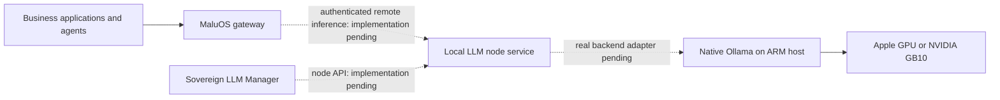

# Stage 3 alternative: ARM inference hosts without MaluOS

**Your place in the roadmap:** [Choose a compute path](11-compute-roadmap.md). Read sections 1–2, follow the [Mac](11-gpu-macos.md) or [Spark](11-gpu-dgx-spark.md) guide, and use section 3 for its office connection test. Finish the hardware guide’s lifecycle checks, then review sections 4–5 here. The operator path currently stops at host preparation; node implementation is pending.

Keep macOS on an Apple Silicon Mac and NVIDIA DGX OS on a DGX Spark.
These machines can run local models without installing the MaluOS ISO,
the Business OS kernel or a database server. The intended MaluOS component
for these hosts is
[maluos-local-llm-server](https://github.com/maludb/maluos-local-llm-server).

**Repository check — November 9, 2026:** its purpose matches this topology,
but it is not yet an installable inference service. At commit
`3328e84a655ee228635215c571bb2030aa91091f`, the repository contains the
SQLite store, keys, scheduler and a simulated backend. It has no real
Ollama adapter, HTTP server, CLI, package installer or launchd/systemd
service definitions. The design's `sllm` commands and API routes are
planned interfaces. Do not treat them as available commands.

The guides below install the native model runtime and prove GPU inference
and private connectivity. Production integration with MaluOS remains
pending the node service and compatibility work described here.

| Host | Installation guide | What can be completed now |
|---|---|---|
| Apple Silicon Mac | [macOS GPU host](11-gpu-macos.md) | Native Ollama, Metal acceleration, local model and SSH-forwarded API test |
| DGX Spark | [DGX Spark GPU host](11-gpu-dgx-spark.md) | DGX OS, native ARM64 Ollama, NVIDIA GPU verification and SSH-forwarded API test |
| Supported MaluOS hardware | [MaluOS GPU server](11-gpu-server.md) | Packaged gateway and estate sharing path |

## 1. Place the host in the network

Reserve a private address or stable DNS name and record the machine's
owner, operating system, runtime version, model IDs, memory, storage and
permitted callers. Use wired networking for a stationary inference host.
Size models for the memory left after the OS, context and concurrent
requests; the examples start with a small validation model.

The intended serving path is:



The dashed connections are not available in the reviewed node repository.
Ollama itself can be installed today. Keep its API on `127.0.0.1:11434`;
the temporary SSH test below provides an authenticated encrypted path.
The planned node API uses port 11435, but nothing in the current repository
starts a listener there. A web reverse proxy does not forward SSH.

## 2. Install the host runtime

Complete the [Mac](11-gpu-macos.md) or [Spark](11-gpu-dgx-spark.md) guide
through its local API test, then return here. Both configure local-only
Ollama and leave port 11434 off the LAN. No model download or installation
is performed by reading these documents.

## 3. Prove inference from the office over SSH

Enable SSH access for the selected operator on the inference host and
install that operator's public key through the normal management process.
Use its private address, VPN address or an SSH jump host, rather than the
Business OS application's HTTPS domain. Verify the SSH host fingerprint
against the host's console or administrator record.

In a Bash terminal on the **office** or a test workstation:

```bash
read -r -p 'Inference host SSH account: ' GPU_USER
read -r -p 'Inference host private DNS name or address: ' GPU_HOST
ssh -N -o ExitOnForwardFailure=yes -o ServerAliveInterval=30 \
  -o ServerAliveCountMax=3 -L 127.0.0.1:21434:127.0.0.1:11434 \
  "$GPU_USER@$GPU_HOST"
```

Keep this terminal open. In a second terminal on that same caller:

```bash
curl --fail --silent --show-error http://127.0.0.1:21434/api/tags
curl --fail --silent --show-error http://127.0.0.1:21434/api/chat \
  -H 'Content-Type: application/json' \
  -d '{"model":"qwen3:0.6b","messages":[{"role":"user","content":"Say hello in five words."}],"think":false,"stream":false}'
```

Expect a model list and a completed answer. On the inference host, run
`ollama ps` while the model is loaded and verify GPU placement. Repeat
with a streaming request (`"stream":true`, `curl -N`) if the application
will stream. The [native chat API](https://docs.ollama.com/api/chat)
returns usage and timing fields for recording the proof.

Close the SSH tunnel with Ctrl-C after the test. This proves the network
and runtime only: it does not install a queue service, grant per-caller
model permissions, write the MaluOS ledger or enrol an estate node.
Other local processes on the calling machine can access the forwarded
port while the tunnel is open. A production connection needs managed
service lifecycle and the node's authentication/authorization layer.

## 4. Complete the node service before production registration

The [shared inference-node contract](https://github.com/maludb/maluos/blob/a6f8580e8be53cb915728a8cb940751f194427a0/docs/inference-node-api.md)
is newer than the standalone repository's design. Align the implementation
with that contract before writing installation commands:

| Required work | Acceptance evidence |
|---|---|
| Real Ollama backend | Chat, stream, embedding and model operations reach a real runtime; failures and cancellation propagate |
| Inference faces | Implement the agreed paths and authentication; the MaluOS `remote` adapter uses `/api/tags`, `/api/chat`, `/api/generate` and `/api/embed` |
| Management API | `/node/v1` health/status, queue, runs, models and keys interoperate with the manager's actual client |
| Host packaging | Reproducible dependencies, install/upgrade/uninstall instructions, macOS launchd and Linux systemd definitions, persistent configuration and data ownership |
| Credentials and policy | Separate inference and management keys, issue/revoke flow, refusal of unauthorized calls, local-only enforcement and explicit cloud permission |
| Network integration | Verified private endpoint, protected transport and restart recovery; decide manual gateway pairing versus estate enrolment |
| Operations | Queue/usage visibility, backup and restore, retention, GPU facts, service recovery and tests on both platforms |

The older design uses `/openai/v1/...` and `/anthropic/v1/...`; the shared
contract uses `/v1/...` faces and adds the Ollama-native face. They are not
interchangeable URL prefixes. The current remote adapter is documented in
[remote.py](https://github.com/maludb/maluos/blob/a6f8580e8be53cb915728a8cb940751f194427a0/packages/maluos-gateway/lib/maluos_gateway/remote.py).

Do not run `maluctl estate join` on these hosts: this repository ships no
MaluOS estate client. Manual pairing and automatic estate discovery are
separate capabilities. Likewise, pointing `ollama_local` at a network host
misrepresents its location to policy, while `openai_compat` is currently
classified as cloud by the gateway. Neither is the documented private-node
integration. The
[gateway CLI](https://github.com/maludb/maluos/blob/a6f8580e8be53cb915728a8cb940751f194427a0/packages/maluos-gateway/lib/maluctl.d/gateway.py)
and remote adapter need to agree with the completed node implementation.

Once that implementation exists, publish concrete instructions to install
the service, mint an inference key, store it in the calling gateway's
vault, register a `remote` backend, choose a model alias/tier and test the
real application's identity. Add management credentials separately if
using Sovereign LLM Manager. Do not reuse a management key for inference.

## 5. Acceptance and hybrid use

Record these as separate milestones:

- **Host prepared:** native runtime installed; model answers with GPU
  acceleration; loopback API and private SSH test pass.
- **Node service ready:** install and reboot recovery work; authenticated
  APIs, queue, model management and usage pass on the selected hardware.
- **MaluOS integration ready:** an application/agent call reaches the node
  through the gateway; caller policy and usage are verified; revocation,
  node outage and reconnection behave correctly.

Only the first milestone has executable instructions in this revision.
None has been validated on physical target hardware during documentation.
The repository review and test outcome are in the
[verification note](docs/arm-inference-verification-2026-11-09.md).

After private-node integration passes, apply [hybrid routing](11-hybrid-compute.md)
on the calling MaluOS gateway. Keep cloud fallback there initially and
keep the ARM runtime local-only, so the selected private route cannot
silently forward its prompts to a cloud model. Verify that loss of the ARM
node fails for a private-only caller and uses only an approved alternative
for a cloud-enabled caller. More ARM hosts repeat the same installation
and registration; they do not automatically combine memory into one model.

